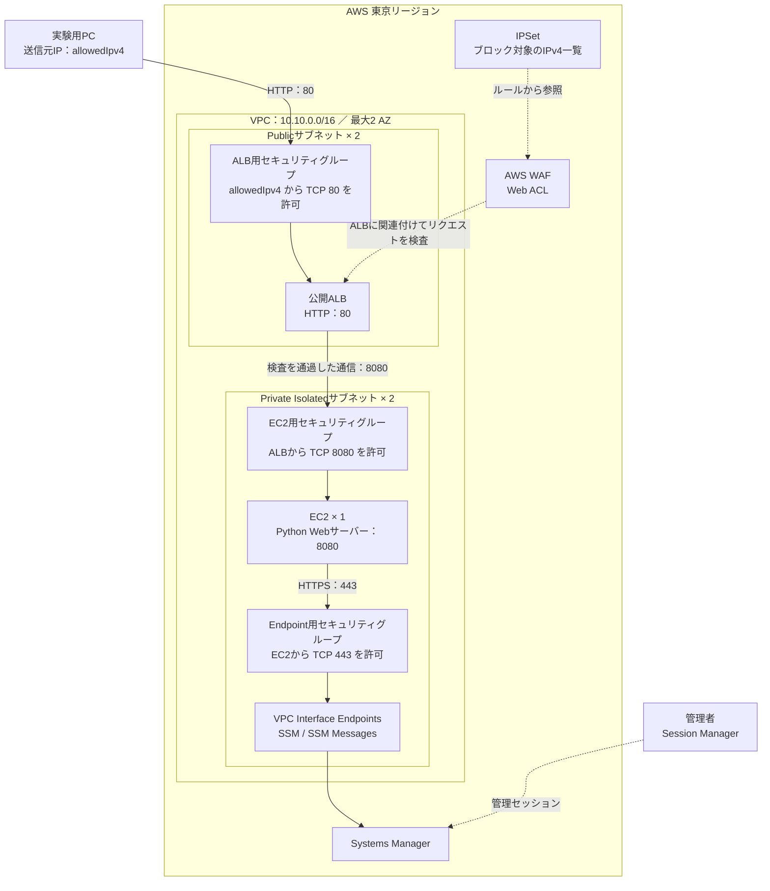
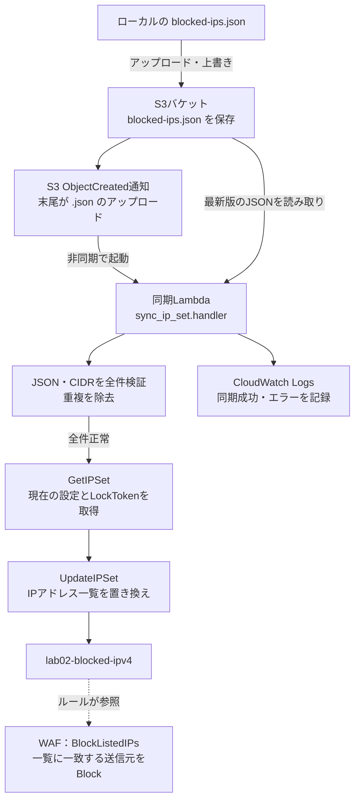
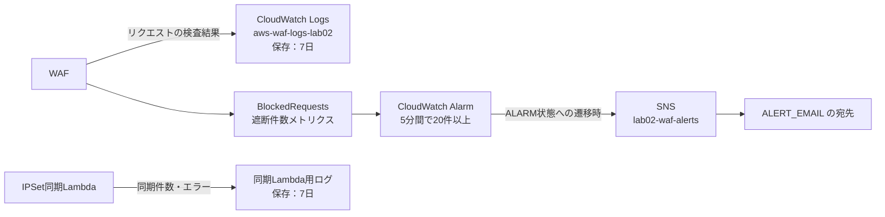

# Lab02の構成とIPSet同期の仕組み

更新日：2026年11月11日

この文書は、`feature/ipset` ブランチのローカルコードに基づく構成説明です。AWS上のデプロイ状況・動作確認結果を保証するものではありません。

Lab02は、Webアクセスを受け付けるネットワークと、S3上のJSONからブロック対象IPを更新する仕組みを組み合わせています。

## 1. Webアクセスとネットワーク



図中のセキュリティグループは通信制御を説明するために描いています。独立した中継装置ではなく、ALB・EC2・Endpointに関連付ける設定です。同様に、WAFも独立したサーバーへ通信を転送するものではなく、ALBに関連付けてリクエストを検査するサービスです。

- ALBは2つのPublicサブネットを使いますが、Web用EC2は現在1台です。
- EC2は外部への経路を持たないIsolatedサブネットにあります。NAT Gatewayはありません。
- EC2はAmazon Linux 2023、インスタンスタイプは`t3.micro`です。IMDSv2を必須にしています。
- EC2の管理はSSM用Endpoint経由で行う構成です。SSHの22番ポートは開けていません。
- ALBはHTTPの80番で受け付け、EC2の8080番へ転送します。`/health`で稼働確認します。
- WebサーバーはEC2起動時のUser Dataで配置され、systemdで起動します。

セキュリティグループとWAFは両方適用されます。ALBのセキュリティグループは`allowedIpv4`以外からの接続を許可しないため、WAFのIPブロック実験にはALBまで到達できる送信元を使います。

## 2. S3からIPSetを更新する流れ



このLambdaはVPC内へ配置していません。Web用EC2とは独立して、S3とWAFのAPIを呼び出します。WAFはWebリクエストごとにS3を読み込むのではなく、同期されたIPSetを使って判定します。

### JSONの例

```json
{
  "addresses": [
    "192.0.2.10/32",
    "198.51.100.0/24"
  ]
}
```

これらは例示用IPです。単一IPv4は`/32`、範囲は`/24`などのCIDR形式で登録します。

| 操作・状態 | 結果 |
|---|---|
| JSONにIPを追加してアップロード | IPSetにも追加 |
| JSONからIPを削除してアップロード | IPSetからも削除 |
| `{"addresses": []}`をアップロード | ブロック対象を全件解除 |
| JSONやCIDRが不正 | 更新せずエラー終了。既存IPSetを維持 |
| S3のファイル自体を削除 | 削除イベントは対象外なので、IPSetは変更されない |

通知は現在、バケット内の`.json`ファイルの作成・上書きが対象です。ただし、Lambdaが読むファイルは常にバケット直下の`blocked-ips.json`の最新版です。

### LambdaとS3の設定

| 項目 | 設定 |
|---|---|
| Lambdaランタイム | Python 3.12 |
| ハンドラー | `sync_ip_set.handler` |
| メモリ・タイムアウト | 128 MB・30秒 |
| 同時実行数 | 1 |
| S3アクセス権限 | 対象バケットの`blocked-ips.json`の読み取り |
| WAFアクセス権限 | 対象IPSetの`GetIPSet`・`UpdateIPSet` |
| 入力検証 | IPv4 CIDR、`/0`拒否、重複除去、最大10,000件 |
| 更新競合 | LockTokenを再取得して最大3回試行 |
| S3公開アクセス | 全ブロック |
| S3保存 | S3管理の暗号化、HTTPS必須、バージョン管理あり |
| Stack削除時のS3 | `RETAIN`。バケットとオブジェクトは残る |

Lambdaの環境変数は`ip_list.py`で渡します。

| 環境変数 | 用途 |
|---|---|
| `IP_LIST_BUCKET` | 読み取り元のバケット名 |
| `IP_LIST_KEY` | 読み取り元のキー。`blocked-ips.json` |
| `IP_SET_NAME` | 更新対象IPSetの名前 |
| `IP_SET_ID` | 更新対象IPSetのID |

## 3. WAFルールの評価順序

数値の小さい優先順位から評価します。

| 優先順位 | ルール | 動作 |
|---:|---|---|
| 0 | `BlockListedIPs` | IPSetに一致した送信元をBlock |
| 10 | `AWSManagedRulesCommonRuleSet` | グループの結果をCountに上書き |
| 20 | `AWSManagedRulesSQLiRuleSet` | SQLi検知時にBlock |
| 30 | `Lab02RateLimit` | 送信元IPごとに直近60秒・100件を基準に制限 |
| 最後 | デフォルト | Allow |

先頭のIPSetルールでBlockされたリクエストは、後続ルールやEC2へ進みません。CommonRuleSetのCountは検査結果を記録し、その後の評価へ進みます。レート制限は厳密な「101件目の遮断」を保証する設定ではありません。

## 4. ファイルとリソースの対応

以下のパスは`labs/lab02/`を基準にしています。

| ファイル | 設定・処理している内容 |
|---|---|
| [app.py](../labs/lab02/app.py) | CDKの起点。`Lab02Stack`を東京リージョンで起動 |
| [lab02/lab02_stack.py](../labs/lab02/lab02/lab02_stack.py) | 各作成関数を呼び、VPC・EC2・ALB・WAF・S3・Lambdaを接続。確認用Outputsも定義 |
| [lab02/resources/network.py](../labs/lab02/lab02/resources/network.py) | VPC、サブネット、3種類のセキュリティグループ、SSM用Endpoint |
| [lab02/resources/compute.py](../labs/lab02/lab02/resources/compute.py) | EC2、SSM用IAMロール、起動時に作るPython Webサーバーとsystemdサービス |
| [lab02/resources/load_balancer.py](../labs/lab02/lab02/resources/load_balancer.py) | 公開ALB、HTTPリスナー、EC2への転送、`/health`のヘルスチェック |
| [lab02/resources/waf.py](../labs/lab02/lab02/resources/waf.py) | IPSet、Web ACL、ルールと優先順位、ALBとの関連付け |
| [lab02/resources/ip_list.py](../labs/lab02/lab02/resources/ip_list.py) | S3バケット、同期Lambda、IAM権限、環境変数、S3通知、Lambdaログ保存先 |
| [application/sync_ip_set.py](../labs/lab02/application/sync_ip_set.py) | AWS上で動くLambda本体。JSON取得、CIDR検証、IPSet更新、競合時の再試行 |
| [blocked-ips.json](../labs/lab02/blocked-ips.json) | ブロック対象一覧。S3へアップロードして運用 |
| [lab02/resources/monitoring.py](../labs/lab02/lab02/resources/monitoring.py) | WAFログ、遮断件数のCloudWatch Alarm、SNSメール通知 |

`resources/`の各Pythonファイルは、ローカルやCIで実行してAWS構成を定義するコードです。`application/sync_ip_set.py`はLambdaへアップロードされ、AWS上で実行されます。

### 設定値の入口とOutputs

- CDKコンテキスト`allowedIpv4`：ALBへの接続を許可する送信元CIDR。
- 環境変数`ALERT_EMAIL`：SNSメール通知先。
- `app.py`：デプロイ先リージョンを`ap-northeast-1`に指定。アカウントは`CDK_DEFAULT_ACCOUNT`から取得。
- `lab.sh`：`.env`と仮想環境を読み込み、ログイン・合成・差分確認・デプロイを実行する補助スクリプト。

StackのOutputsには、`WebInstanceId`、`WebInstancePrivateIp`、`AlbDnsName`、`AlbUrl`、`VpcId`、`IpListBucketName`、`BlockedIpSetId`、`IpListSyncFunctionName`を出力します。

## 5. ログと通知



WAFログでは「どの通信をどのルールが判定したか」、Lambdaログでは「IPリストの同期が成功したか」を確認します。メール通知はSNSの購読確認を完了してから受信できます。この図はコード上の監視構成を表しており、実際のメトリクス取得・アラーム発報・メール到達は動作確認が必要です。

## 6. コンソールでの確認

同じAWSアカウント・東京リージョンで確認します。

1. **S3**：Outputsの`IpListBucketName`のバケットで、`blocked-ips.json`の存在を確認。
2. **Lambda**：`IpListSyncFunctionName`の関数を開き、「モニタリング → CloudWatchログを表示」で実行結果を確認。
3. **WAF → IP sets**：東京リージョンの`lab02-blocked-ipv4`で、JSONと同じIPが登録されていることを確認。
4. **WAFのWeb ACL**：`lab02-web-acl`で、ルールとALBの関連付けを確認。

同期成功ログの例：

```text
IPSet synchronized: address_count=1
```

IPSetへの同期確認と、実際の通信遮断の確認は別です。遮断試験では、ALBまで到達できる送信元IPをリストへ登録し、WAFログの一致ルールも確認します。

## 7. 変更時の使い分け

- **IP追加・削除**：JSON編集 → S3へアップロード → LambdaログとIPSetを確認。
- **ネットワークやルール構成の変更**：Pythonコード編集 → `cdk synth` → `cdk diff` → `cdk deploy`。

IPSetをコンソールで直接編集するとS3の内容と不一致になります。通常のIP一覧更新はS3から行います。

CDKの`addresses=[]`は作成時の初期値であり、Lambdaによる更新内容はCloudFormationテンプレートには反映されません。IPSetの再作成・構成変更時には、S3から再同期して実際の一覧を確認します。
