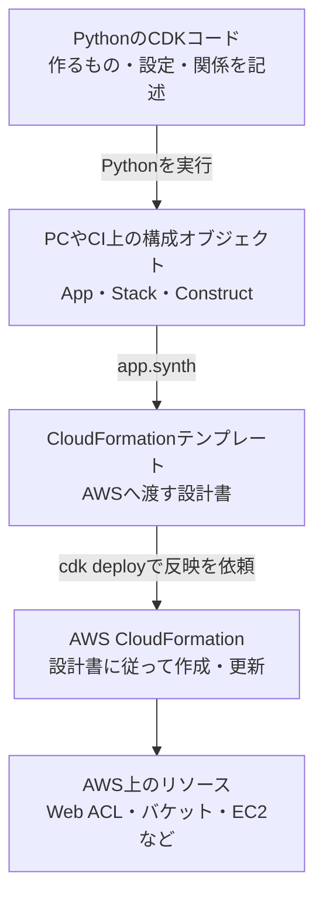
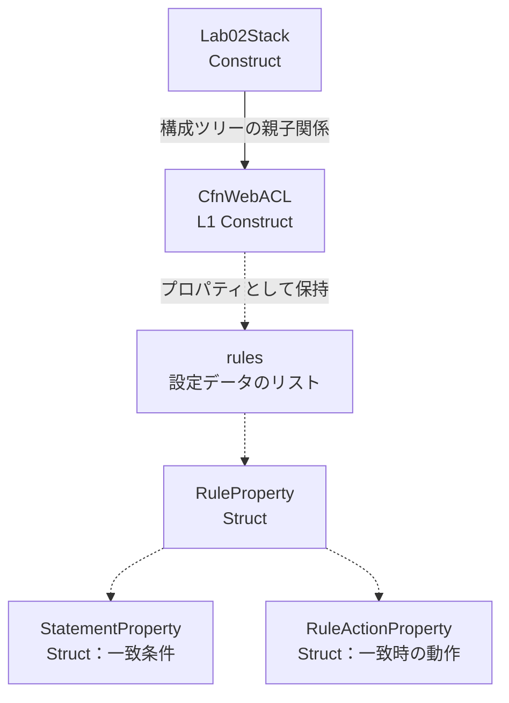
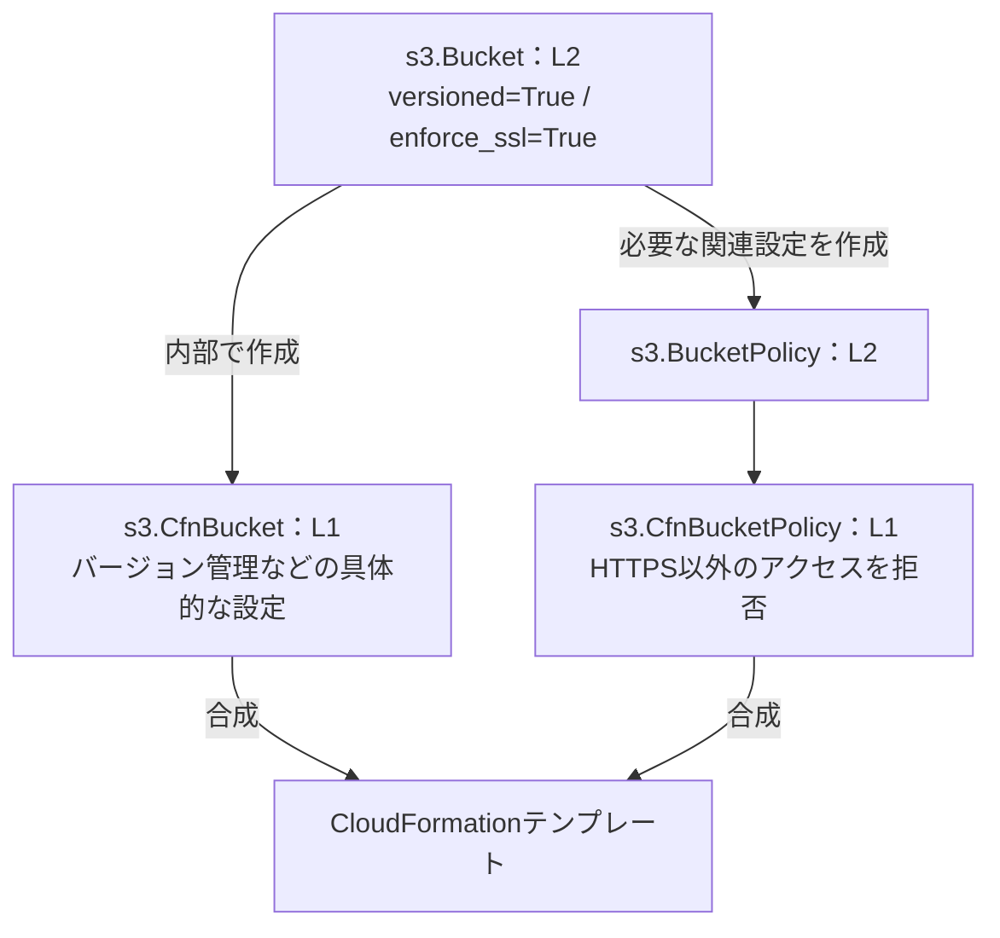
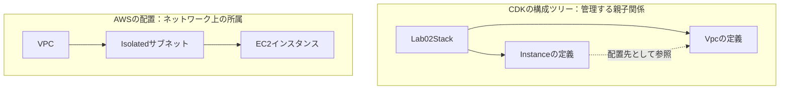

# Lab02で理解するAWS CDK：Construct・Struct・scopeの関係

更新日：2026年11月12日

この文書は、PythonとAWSに詳しくない方が、Lab02のコードからCDKの動きを理解するための解説です。現在のソースコードとローカルに生成済みの`tree.json`を例にしています。生成済みファイルは最後に合成した時点の内容であり、AWS上の実際の設定や最新コードとの一致を保証するものではありません。

コード例には、説明に必要な部分だけを抜き出したものや疑似コードも含みます。特記しない限り、ファイル全体を置き換えるためのコードではありません。

## 1. CDKは「AWSで動く本体」ではなく「構成の設計書」を組み立てる

AWSは、S3・WAF・EC2などのサービスを提供しています。CDKでは、それらについて「何を作り、どのように設定するか」をPythonなどで記述します。

例えば`CfnWebACL`のインスタンスは、PC上で通信を検査するWAF本体ではありません。AWS上に作成するWeb ACLの設定を表す、Python側のオブジェクトです。



Pythonオブジェクト自体がAWSへ移動するのではありません。そこからテンプレートを生成し、AWSがその内容を反映します。`cdk deploy`も必要に応じて合成を行うため、図は概念的な段階を表しています。

| 操作 | 主な目的 |
|---|---|
| `cdk synth` | 構成定義からテンプレートなどを生成する |
| `cdk diff` | ローカルの定義と、デプロイ済み構成との差分を確認する |
| `cdk deploy` | AWS上のリソースを作成・更新する |

## 2. モジュール・クラス・インスタンスを区別する

対象：[waf.py](../labs/lab02/lab02/resources/waf.py)

```python
from aws_cdk import aws_wafv2 as wafv2
```

`aws_wafv2`は、WAF V2に関するCDKの部品をまとめたモジュールです。`as wafv2`は、それを短い名前で使う指定です。`wafv2`自体が型なのではありません。

```text
aws_cdk
└── aws_wafv2：モジュール。別名 wafv2
    ├── CfnWebACL：クラス
    ├── CfnIPSet：クラス
    └── CfnWebACLAssociation：クラス
```

```python
web_acl = wafv2.CfnWebACL(...)
```

このコードを分けて読むと、次の意味です。

| 部分 | 意味 |
|---|---|
| `wafv2` | 使う部品が入ったモジュール |
| `.CfnWebACL` | その中から取り出すクラス |
| `(...)` | クラスを呼び出し、インスタンスを作成・初期化する |
| `web_acl =` | 作成したインスタンスへの参照を変数に保存する |

型を明記するなら、`web_acl: wafv2.CfnWebACL`となります。ただし、そのインスタンスはAWS上の実物ではなく、実物の設定を組み立てるオブジェクトです。

## 3. ConstructとStructは何が違うか

| 用語 | 役割 | Lab02の例 |
|---|---|---|
| Construct | CDKの構成ツリーへ登録される部品 | `CfnWebACL`、`Bucket`、`Vpc` |
| Struct | 設定項目をひとまとめにしたデータ型 | `RuleProperty`、`StatementProperty` |

例えば、Web ACLは検査ルールのまとまりです。Web ACLを表すConstructへ、個々のルールを表すStructを渡します。



実線はConstructの親子関係、点線は設定データとしての包含関係です。`RuleProperty`を作るだけでは、独立したConstructとして登録されません。Constructへ設定として渡すことで、そのテンプレートの一部になります。

### 実際のルール設定の例

```python
rule = wafv2.CfnWebACL.RuleProperty(
    name="AzureAsnTest",
    priority=5,
    action=wafv2.CfnWebACL.RuleActionProperty(count={}),
    statement=wafv2.CfnWebACL.StatementProperty(
        asn_match_statement=(
            wafv2.CfnWebACL.AsnMatchStatementProperty(
                asn_list=[8075],
            )
        )
    ),
    visibility_config=visibility("AzureAsnTest"),
)
```

これで作るのは「ASN 8075に一致したらCountする」という設定データです。`rules=[rule]`のようにWeb ACLへ渡して使います。

StructもPythonではオブジェクトとして作成しますが、CDKの構成部品であるConstructとは役割が違います。ここでいうStructは、C言語の構造体のような物理メモリ配置やPythonの`struct`モジュールを意味しません。

## 4. L1 Construct：CloudFormationに直接対応する部品

L1はLevel 1の略です。`Cfn`はCloudFormationを表す名前で、CDKのL1リソースクラスには通常この接頭辞が付きます。

| CDKのL1クラス | テンプレート上のリソース型 |
|---|---|
| `wafv2.CfnWebACL` | `AWS::WAFv2::WebACL` |
| `wafv2.CfnIPSet` | `AWS::WAFv2::IPSet` |
| `s3.CfnBucket` | `AWS::S3::Bucket` |

Lab02では次のようにIPSetを定義しています。

```python
blocked_ip_set = wafv2.CfnIPSet(
    scope,
    "Lab02BlockedIpSet",
    name="lab02-blocked-ipv4",
    scope="REGIONAL",
    ip_address_version="IPV4",
    addresses=[],
    description="IPv4 block list synchronized from S3",
)
```

L1では、CloudFormationへ渡す項目に近い形で設定します。`addresses=[]`は作成時の初期一覧です。運用中の一覧は、別のLambda処理によって更新しています。

## 5. L2 Construct：内部でL1を組み立てる便利な部品

L2はLevel 2の略です。設定しやすい引数や、権限の付与などの補助メソッドを用意し、内部で必要なL1や関連Constructを組み立てます。

| 比較 | L1 | L2 |
|---|---|---|
| 例 | `s3.CfnBucket` | `s3.Bucket` |
| 指定のしかた | CloudFormationに近い設定 | 意図を短く指定できる設定 |
| 関連設定の組み立て | 明示的に記述する部分が多い | 補助機能が組み立てる部分がある |
| 最終的な反映先 | CloudFormation | 内部のL1などを通じてCloudFormation |

### Lab02のBucketを追う

対象：[ip_list.py](../labs/lab02/lab02/resources/ip_list.py)

```python
return s3.Bucket(
    scope,
    "Lab02IpListBucket",
    block_public_access=s3.BlockPublicAccess.BLOCK_ALL,
    encryption=s3.BucketEncryption.S3_MANAGED,
    enforce_ssl=True,
    versioned=True,
    removal_policy=RemovalPolicy.RETAIN,
)
```

`Bucket`の内部では、別の`CfnBucket`インスタンスが作られます。L2がL1に変身するのではありません。また、`Bucket`が`CfnBucket`を継承しているという関係でもありません。**L2がL1を内部に持つ関係**です。



| L2での指定 | 生成される設定の例 |
|---|---|
| `versioned=True` | `VersioningConfiguration.Status = Enabled` |
| `encryption=S3_MANAGED` | バケットの暗号化方式を`AES256`に設定 |
| `block_public_access=BLOCK_ALL` | 公開アクセス制限の4項目を有効化 |
| `enforce_ssl=True` | 安全な通信でないアクセスを拒否するポリシーを追加 |
| `removal_policy=RETAIN` | `DeletionPolicy`・`UpdateReplacePolicy`を`Retain`に設定 |

内部実装を簡略化してPython風に表すと、次のような処理です。実際のCDKソースをそのまま転載したコードではありません。

```python
# 疑似コード：Bucket自身を親に、L1を組み立てる
cfn_bucket = s3.CfnBucket(
    self,
    "Resource",
    versioning_configuration=(
        s3.CfnBucket.VersioningConfigurationProperty(
            status="Enabled"
        )
    ),
    # その他の設定
)
```

この時点でL1オブジェクトが構成ツリーに存在します。`synth`は、その定義をテンプレートへ出力する段階です。

### Vpcは複数のリソースを組み立てる

対象：[network.py](../labs/lab02/lab02/resources/network.py)

Lab02の`ec2.Vpc(...)`では、最大2 AZ、PublicとIsolatedのサブネット、NAT Gatewayなし、という意図を指定しています。

L2の`Vpc`は、VPC本体だけでなく、サブネット、ルートテーブル、ルート、インターネットゲートウェイなどの定義も組み立てます。L1だけで同じ構成を作るなら、それらを個別に定義して関連付ける必要があります。

## 6. scope：CDK上の親を指定する

対象：[app.py](../labs/lab02/app.py)、[lab02_stack.py](../labs/lab02/lab02/lab02_stack.py)

```python
app = cdk.App()

Lab02Stack(
    scope=app,
    construct_id="Lab02Stack",
    # デプロイ先などの設定
)

app.synth()
```

ここでは`app`を親にして、`Lab02Stack`を登録しています。

Stack内部では、次のように`self`を渡しています。

```python
web_acl, blocked_ip_set = create_waf(self, alb)
```

`self`は、いま処理している`Lab02Stack`インスタンスです。関数側では`scope`という引数名で受け取ります。

```python
def create_waf(scope, alb):
    web_acl = wafv2.CfnWebACL(
        scope,
        "Lab02WebAcl",
        # 設定
    )
```

したがってWeb ACLの親は、`waf.py`というファイルではなく`Lab02Stack`です。

```text
App
└── Lab02Stack
    ├── Lab02WebAcl
    ├── Lab02BlockedIpSet
    ├── Lab02IpListBucket
    └── ...
```

どのファイルへ書いたかではなく、**どのConstructをscopeへ渡したか**でCDK上の親子関係が決まります。

### 同じ名前のscopeでも意味が違う場合がある

```python
wafv2.CfnIPSet(
    scope,                 # CDK上の親
    "Lab02BlockedIpSet",   # 親の中で識別するID
    scope="REGIONAL",      # WAFの適用範囲
    # その他の設定
)
```

第1引数の`scope`とWAF設定の`scope="REGIONAL"`は別物です。後者は「リージョン用か、CloudFront用か」というサービス側の区分です。

## 7. CDKの親子関係と、AWS上のネットワーク配置は別

`aws_ec2`モジュールは、EC2インスタンスだけでなく、VPC・サブネット・セキュリティグループなどの部品もまとめています。モジュールの分類は、AWS上の包含関係を表していません。

```python
web_instance = ec2.Instance(
    scope,                     # CDK上の親：Lab02Stack
    "WebInstance",
    vpc=vpc,                   # 配置するVPC
    vpc_subnets=ec2.SubnetSelection(
        subnet_type=ec2.SubnetType.PRIVATE_ISOLATED,
    ),
    # その他の設定
)
```



「EC2はVPC内のサブネットに配置される」という理解は正しいです。一方、Lab02のCDKツリーでは、VPCとEC2の定義はどちらもStackの子です。

## 8. Stackを変数へ代入しなくてもよい理由

`app.py`では、`Lab02Stack(...)`の結果を変数に代入していません。それでも、作成時にApp配下へ登録されるので、`app.synth()`がその構成をたどれます。

```python
# どちらもStackをApp配下へ登録する
Lab02Stack(scope=app, construct_id="Lab02Stack", ...)

# 作成後にも参照したいなら変数へ保存できる
stack = Lab02Stack(scope=app, construct_id="Lab02Stack", ...)
```

上は比較のための抜粋です。同じAppに同じIDで2回作成する、という意味ではありません。

### 仮のメモリアドレスで追う

次は説明用の疑似命令です。実際のPython命令・メモリ配置ではありません。CDKのPythonとJavaScript間の連携も省略しています。

```text
CALL App() → @100
STORE app, @100

ALLOC Lab02Stack → @200
CALL __init__(self=@200, scope=@100)
    CALL super().__init__(...)
    REGISTER_CHILD @100, "Lab02Stack", @200
    DEFINE 子のConstruct群
RETURN __init__ → None
RETURN Lab02Stack(...) → @200

DISCARD 作成結果への一時参照

CALL app.synth()
WALK App(@100) → Stack(@200) → 子のConstruct群
EMIT テンプレート
```

`__init__()`の返り値は`None`です。一方、クラス呼び出し全体の結果は作成したインスタンスです。代入しない場合に捨てるのは、その結果への一時的な参照です。CDKの構成ツリーへの登録まで取り消すわけではありません。

## 9. rules内で関数を呼ぶ理由

対象：[waf.py](../labs/lab02/lab02/resources/waf.py)

```python
def rate_limit_rule():
    return wafv2.CfnWebACL.RuleProperty(
        name="Lab02RateLimit",
        priority=30,
        # 条件や動作など
    )
```

この関数は、ルール設定を作って返します。その場で通信を制限する処理を実行するわけではありません。

```python
# 同じ意味になる書き方の比較
rules = [rate_limit_rule()]

# 分解すると
rate_rule = rate_limit_rule()
rules = [rate_rule]
```

| 記述 | 意味 |
|---|---|
| `rate_limit_rule()` | 関数を呼び、返された設定データを受け取る |
| `rate_limit_rule` | 関数そのものを参照する |

`rules`に必要なのはルール設定なので、`()`を付けます。関数化はコードの整理方法です。直接`RuleProperty(...)`を書いても、同じ設定を返すなら生成結果は同じです。

現在の`BlockListedIPs`や`AzureAsnTest`も、同様の関数へ切り出せます。ただし、この文書の作成時点では、その2つは`rules`内へ直接記述されています。

### managed_ruleの切り替えも、設定データの組み立て

```python
override_action=wafv2.CfnWebACL.OverrideActionProperty(
    none={} if block_enabled else None,
    count={} if not block_enabled else None,
),
```

| `block_enabled` | 作る設定 | WAF上の意味 |
|---|---|---|
| `True` | `none={}` | グループ本来の結果を使う |
| `False` | `count={}` | グループの結果をCountへ上書きする |

`True`は必ず全通信をBlockする指定ではありません。引数名の`none`はWAFの「上書きしない」、値の`None`はPythonの「この項目を指定しない」を表します。`{}`はその動作を選択するための空の設定データです。

この上書きは、グループ内部の各ルールをすべてCountに変えるものではありません。内部の評価を終えたグループの結果を変更します。

## 10. tree.jsonとtemplate.jsonの対応

| ファイル | 主に見るもの |
|---|---|
| `cdk.out/tree.json` | Constructの親子関係、クラス情報 |
| `cdk.out/Lab02Stack.template.json` | CloudFormationへ渡すリソース定義・設定・参照 |

生成済みの`tree.json`では、主要部分が次のようになっています。補助リソースや一部の子は省略しています。

```text
Lab02Stack
├── SaasWebVpc                         Vpc：L2
│   ├── Resource                      CfnVPC：L1
│   ├── PublicSubnet1                 PublicSubnet：L2
│   ├── PublicSubnet2                 PublicSubnet：L2
│   ├── PrivateAppSubnet1             PrivateSubnet：L2
│   ├── PrivateAppSubnet2             PrivateSubnet：L2
│   └── IGW                           CfnInternetGateway：L1
├── WebInstance                       Instance：L2
│   ├── Resource                      CfnInstance：L1
│   └── LaunchTemplate                CfnLaunchTemplate：L1
├── Lab02WebAcl                       CfnWebACL：L1
├── Lab02IpListBucket                 Bucket：L2
│   ├── Resource                      CfnBucket：L1
│   └── Policy                        BucketPolicy：L2
│       └── Resource                  CfnBucketPolicy：L1
└── Lab02IpListSync                   Function：L2
    ├── ServiceRole                   Role：L2
    ├── Code                          Asset
    └── Resource                      CfnFunction：L1
```

L2の内部に作られたL1などが、`children`として現れています。`CfnWebACL`の`RuleProperty`などはStructなので、Constructの子としては現れず、プロパティ側に入ります。

ただし、**childrenの有無だけでL1・L2を判定することはできません。** L1へ子を追加することもできますし、既存リソースを参照するL2では新しいL1を作らない場合もあります。`constructInfo.fqn`のクラス名も確認します。

例えば、Bucketの内部L1は次の情報で確認できます。

```json
{
  "id": "Resource",
  "constructInfo": {
    "fqn": "aws-cdk-lib.aws_s3.CfnBucket"
  }
}
```

対応するテンプレートでは、次のようになります。いずれも抜粋です。

```json
{
  "Type": "AWS::S3::Bucket",
  "Properties": {
    "VersioningConfiguration": {
      "Status": "Enabled"
    }
  }
}
```

内部のL1をPythonから参照したい場合、今回の新規作成したBucketでは次のように取得できます。

```python
cfn_bucket = ip_list_bucket.node.default_child
print(isinstance(cfn_bucket, s3.CfnBucket))
# True
```

これは型変換ではなく、L2内部の既存のL1オブジェクトを取り出す操作です。

## 11. リソース同士の参照はどうテンプレートへ入るか

```python
arn=blocked_ip_set.attr_arn
```

このような属性は、合成時には実際のARNがまだ決まっていない場合があります。その場合CDKは、後で解決する参照として保持し、テンプレートに`Fn::GetAtt`などを出力します。

```text
Python：blocked_ip_set.attr_arn
    ↓ 合成
テンプレート：対象リソースのArn属性への参照
    ↓ CloudFormationが処理
AWS上の実際のIPSet ARNへ解決
```

このため、`synth`時に実物がなくても、リソース同士の関係を定義できます。

また、`waf.py`から返す`blocked_ip_set`と、`ip_list.py`に渡る`ip_set`は、同じConstructを指す参照です。実際のIP一覧を取得して渡しているわけではありません。

## 12. Lab02のすべてが「設定の定義」なのか

CDK部分の大半は構成定義ですが、AWS上で実行するプログラムも含まれています。

| 部分 | 役割 |
|---|---|
| `app.py`、`lab02_stack.py`、`resources/`のCDK処理 | リソース・設定・関係を定義する |
| `application/sync_ip_set.py` | Lambda上でS3を読み、実際にIPSet更新APIを呼ぶ |
| `compute.py`内の`server_script` | EC2に配置するWebサーバーのコードを文字列として保持する |

`server_script`はCDK実行中には文字列データです。EC2の起動処理によってファイルへ書き出され、その後EC2上で実行されます。

```text
ip_list.py                         sync_ip_set.py
「Lambdaを用意し、コードを配置」 → 「AWS上で同期処理を実行」

compute.pyの構成定義               埋め込まれたserver_script
「EC2と起動時の指示を用意」     → 「EC2上でWebリクエストへ応答」
```

## 13. 読むときの確認ポイント

1. **どこで動くコードか**：構成を定義するPC・CIか、実処理をするLambda・EC2か。
2. **何の型か**：モジュール、Construct、Struct、単なる文字列・辞書・リストか。
3. **誰を親にしているか**：Constructの第1引数のscopeを見る。
4. **どこを参照しているか**：`vpc=`、`attr_arn`、環境変数などを見る。
5. **何が生成されたか**：`tree.json`で構成ツリー、`template.json`で設定と参照を見る。

Constructの戻り値を変数へ入れることは、合成対象への登録条件ではありません。関数内でStack配下へ登録されていれば、関数から返さなくても合成対象になります。戻り値は、別の定義へ渡したり追加設定したりするために利用します。

## 関連ドキュメント

- [Lab02 README](../labs/lab02/README.md)：ディレクトリ一覧と操作の入口。
- [Lab02構成図](lab02-architecture.md)：ネットワークとIPSet同期の全体像。
- [Lab02コード解説](lab02-code-walkthrough.md)：WAF・S3・Lambda間のコードの受け渡し。
- [AWS公式：ConstructとL1・L2・L3](https://docs.aws.amazon.com/cdk/v2/guide/constructs.html)
- [AWS公式：L2内部のL1へのアクセス](https://docs.aws.amazon.com/cdk/v2/guide/cfn-layer.html)
- [AWS公式：CfnWebACL](https://docs.aws.amazon.com/cdk/api/v2/python/aws_cdk.aws_wafv2/CfnWebACL.html)
- [AWS公式：OverrideAction](https://docs.aws.amazon.com/waf/latest/APIReference/API_OverrideAction.html)
- [Python公式：オブジェクトと初期化](https://docs.python.org/3/reference/datamodel.html#object.__init__)
