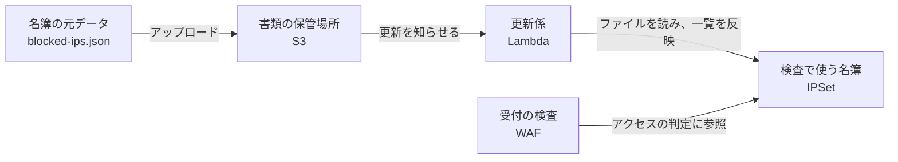
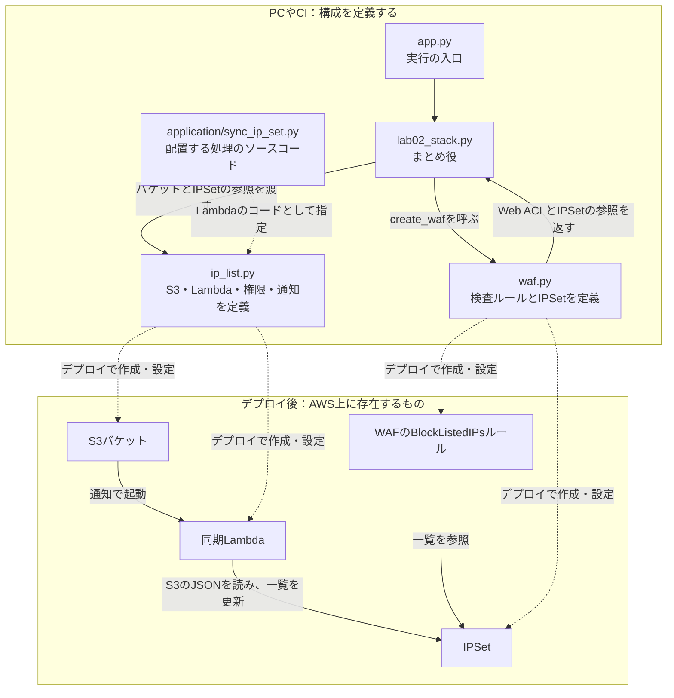
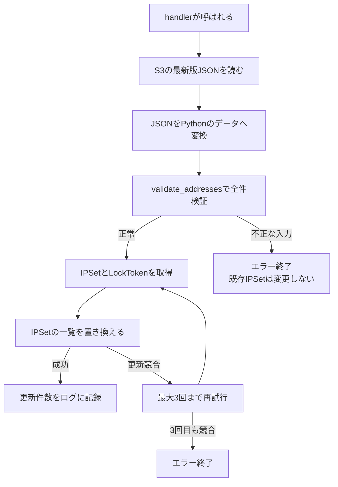
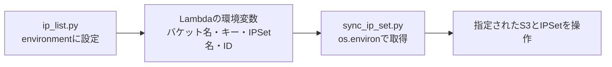

# Lab02のコードを読む：IPブロックの仕組みとファイル同士のつながり

更新日：2026年11月11日

この文書は、AWSに詳しくない方が`waf.py`、`ip_list.py`、`sync_ip_set.py`の関係を理解するための解説です。`feature/asn`ブランチの現在のコードをもとにしています。AWS上のデプロイ状況や実際の動作結果を示す文書ではありません。

## 1. まず「受付と名簿」に例えて考える

Webサイトにアクセスする人を、建物を訪ねてくる人だと考えてみます。

| このラボの仕組み | 建物に例えると | 実際の役割 |
|---|---|---|
| ALB | 建物の受付 | Webアクセスを受け取り、サーバーへ送る |
| WAF | 受付での検査 | リクエストを調べ、通すか遮断するか判断する |
| IPSet | 入場を断る相手の名簿 | ブロック対象のIPアドレス一覧を保持する |
| S3 | 書類の保管場所 | 名簿の元になるJSONファイルを保存する |
| Lambda | 名簿の更新係 | S3のファイルを読み、IPSetへ反映する |
| IAMの権限 | 更新係に渡す鍵・許可証 | ファイルの読み取りやIPSetの更新を許可する |
| CloudWatch Logs | 作業日誌 | 同期の成功やエラーを記録する |

これは役割を理解するための例えです。IPアドレスは通信の送信元を表す情報で、人や会社の本人確認に使える身分証ではありません。



大事なのは、**WAFがアクセスのたびにS3を読むわけではない**ことです。S3の更新時にLambdaがIPSetへ同期し、WAFはそのIPSetを参照します。

## 2. 「仕組みを用意するコード」と「用意した仕組みで動くコード」

このプロジェクトには、実行する目的が違う2種類のPythonコードがあります。

| 種類 | ファイル | いつ・どこで動くか |
|---|---|---|
| AWSの構成を定義する | `app.py`、`lab02_stack.py`、`resources/`のファイル | PCやCIでCDKを実行するとき |
| AWS上で実際の同期作業をする | `application/sync_ip_set.py` | S3通知などでLambdaが起動されたとき |

CDKは、PythonでAWSの構成を書くための道具です。

- `cdk synth`：Pythonの定義を、CloudFormationという仕組みが読める設計書へ変換する。
- `cdk diff`：今回の定義と、AWS上の構成との差分を確認する。
- `cdk deploy`：設計書を使ってAWSのリソースを作成・更新する。

`synth`で`ip_list.py`が実行されても、その場でIPSetの同期処理が走るわけではありません。Lambdaの設定と、配置するコードを設計書へ組み込みます。

## 3. ファイル同士のつながりを図で見る



`sync_ip_set.py`が`waf.py`を読み込んで書き換えるのではありません。すでにAWS上に作られたIPSetを、AWSのAPIを呼んで更新しています。APIとは、プログラムからサービスへ処理を依頼する窓口のことです。

## 4. まとめ役：lab02_stack.py

対象：[lab02_stack.py](../labs/lab02/lab02/lab02_stack.py)

関係するコードは次の部分です。

```python
web_acl, blocked_ip_set = create_waf(
    self,
    alb,
)

ip_list_bucket = create_ip_list_bucket(self)

ip_list_sync = create_ip_list_sync(
    self,
    ip_list_bucket,
    blocked_ip_set,
)
```

順番に読むと、次の意味です。

1. `create_waf(self, alb)`で、ALBに関連付けるWAFとIPSetを定義する。
2. 返ってきた2つの参照を、`web_acl`と`blocked_ip_set`へ受け取る。
3. `create_ip_list_bucket(self)`で、JSONを保存するS3バケットを定義する。
4. そのバケットとIPSetを、同期Lambdaの作成関数へ渡す。

`self`は、このStack自身を指します。Stackは、AWSの構成をまとめて管理する単位です。作成関数へ`self`を渡すことで、「このStackの配下に定義する」と伝えます。

ここで渡す`blocked_ip_set`はIPアドレス一覧そのものではなく、**CDKが扱うIPSetの参照**です。その参照から、リソース名・ID・ARNなどを利用できます。

## 5. waf.py：名簿と、その名簿を使う検査ルール

対象：[waf.py](../labs/lab02/lab02/resources/waf.py)

### 5.1 空のIPSetを定義する

```python
blocked_ip_set = wafv2.CfnIPSet(
    scope,
    "Lab02BlockedIpSet",
    name="lab02-blocked-ipv4",
    scope="REGIONAL",
    ip_address_version="IPV4",
    addresses=[],
    description="IPv4 block list synchronized from S3",
)
```

`wafv2.CfnIPSet(...)`は、CDKでIPSetを定義する書き方です。`Cfn`で始まるクラスは、CloudFormationのリソースに対応しています。

| コード | 意味 |
|---|---|
| 第1引数の`scope` | このリソースをCDK上で所属させる親 |
| `"Lab02BlockedIpSet"` | CDK内で区別するためのID |
| `name="lab02-blocked-ipv4"` | AWS上のIPSet名 |
| `scope="REGIONAL"` | リージョン単位で使うWAFリソース |
| `ip_address_version="IPV4"` | IPv4を登録する一覧 |
| `addresses=[]` | 作成時の初期一覧は空 |

第1引数の`scope`と、`scope="REGIONAL"`は別の設定です。同じ単語でも、一方はCDK上の親、もう一方はWAFの適用範囲を指します。

### 5.2 IPSetに一致した通信を遮断する

ルールのうち、動作を決める部分です。

```python
name="BlockListedIPs",
priority=0,
action=wafv2.CfnWebACL.RuleActionProperty(block={}),
```

`priority=0`は、現在のルールの中で最初に評価する設定です。`block={}`は、条件に一致したときに遮断するという指定です。空の辞書`{}`でも、`block`を選択したことに意味があります。

その条件は、次のコードで指定しています。

```python
ip_set_reference_statement=(
    wafv2.CfnWebACL.IPSetReferenceStatementProperty(
        arn=blocked_ip_set.attr_arn
    )
)
```

ARNは、AWSリソースを特定するための識別名です。`blocked_ip_set.attr_arn`で「先ほど定義したIPSetのARN」を参照します。

実際のARNやIDがデプロイ時に決まる場合も、CDKはその値への参照として設計書を作ります。手作業でARNをコピーして貼る必要はありません。

**IPSetは名簿を持つだけです。名簿を参照するルールにBlock動作を設定することで、遮断が行われます。**

### 5.3 WAFをALBに関連付け、参照を返す

```python
wafv2.CfnWebACLAssociation(
    scope,
    "Lab02WebAclAssociation",
    resource_arn=alb.load_balancer_arn,
    web_acl_arn=web_acl.attr_arn,
)

return web_acl, blocked_ip_set
```

`CfnWebACLAssociation`は、「このALBへのリクエストを、このWeb ACLで検査する」という関連付けです。Web ACLは検査ルールのまとまりです。

最後の`return`で2つの参照を返し、`lab02_stack.py`がそれぞれ受け取ります。

## 6. ip_list.py：保存場所と更新係を用意する

対象：[ip_list.py](../labs/lab02/lab02/resources/ip_list.py)

このファイルには、主に2つの作成関数があります。

| 関数 | 用意するもの |
|---|---|
| `create_ip_list_bucket()` | S3のバケット |
| `create_ip_list_sync()` | 同期Lambda、ログ、権限、S3通知 |

### 6.1 S3バケットの設定

```python
return s3.Bucket(
    scope,
    "Lab02IpListBucket",
    block_public_access=s3.BlockPublicAccess.BLOCK_ALL,
    encryption=s3.BucketEncryption.S3_MANAGED,
    enforce_ssl=True,
    versioned=True,
    removal_policy=RemovalPolicy.RETAIN,
)
```

公開アクセスを禁止し、保存時に暗号化し、HTTPS通信を必須にしています。バージョン管理により、上書き前の内容も過去バージョンとして残ります。

`RETAIN`は、Stackを削除してもこのバケットを残す設定です。実験を終了するときは、バケットと保存ファイルを別途片付けます。

### 6.2 どのプログラムをLambdaで実行するか

```python
application_dir = (
    Path(__file__).resolve().parents[2] / "application"
)
```

`__file__`は、実行中のPythonファイルの場所です。そこから上の階層へ移動して、`labs/lab02/application/`の場所を求めています。末尾の`/ "application"`は、ここでは割り算ではなくパスをつなぐ書き方です。

Lambdaの定義では、次のように使います。以下は該当箇所の抜粋です。

```python
runtime=lambda_.Runtime.PYTHON_3_12,
handler="sync_ip_set.handler",
code=lambda_.Code.from_asset(str(application_dir)),
```

- `runtime`：Python 3.12で動かす。
- `code`：`application/`のコードを、デプロイ時にLambdaへ配置する。
- `handler`：起動時に`sync_ip_set.py`の`handler()`を呼ぶ。

`lambda_`は、Pythonの予約語`lambda`との衝突を避けるために付けたimportの別名です。

### 6.3 Lambdaへ「読み取り元」と「更新先」を渡す

```python
environment={
    "IP_LIST_BUCKET": bucket.bucket_name,
    "IP_LIST_KEY": object_key,
    "IP_SET_NAME": ip_set.name,
    "IP_SET_ID": ip_set.attr_id,
},
```

環境変数は、実行するプログラムへ渡す設定メモのようなものです。コードに毎回バケット名やIDを書き込まず、設定として渡します。

| 変数 | 伝える内容 |
|---|---|
| `IP_LIST_BUCKET` | どのバケットから読むか |
| `IP_LIST_KEY` | どのファイルを読むか。現在は`blocked-ips.json` |
| `IP_SET_NAME` | どの名前のIPSetを更新するか |
| `IP_SET_ID` | 更新先IPSetのID |

`key`はS3でファイルを特定する名前です。今回はバケット直下の`blocked-ips.json`を指定しています。

### 6.4 操作権限を渡す

```python
bucket.grant_read(sync_function, object_key)
```

これは、Lambdaに対象ファイルの読み取り権限を渡します。保存先を知っているだけでは読めないため、権限も必要です。

WAF側の権限は、次の部分です。

```python
sync_function.add_to_role_policy(
    iam.PolicyStatement(
        actions=[
            "wafv2:GetIPSet",
            "wafv2:UpdateIPSet",
        ],
        resources=[ip_set.attr_arn],
    )
)
```

`actions`は許可する操作、`resources`はその操作を許可する対象です。対象IPSetについて「現在の内容を取得する」「内容を更新する」権限を渡します。

### 6.5 起動のきっかけを設定する

```python
bucket.add_event_notification(
    s3.EventType.OBJECT_CREATED,
    s3n.LambdaDestination(sync_function),
    s3.NotificationKeyFilter(suffix=".json"),
)
```

「S3に末尾が`.json`のファイルが作成・上書きされたら、このLambdaを起動する」という設定です。

現在のコードでは、起動のきっかけになるファイルと実際に読むファイルの指定が分かれています。

- 起動のきっかけ：このバケットの`.json`ファイルの作成・上書き。
- 実際に読むもの：環境変数で指定した`blocked-ips.json`の最新版。

ファイルの削除イベントは設定していないため、S3のファイルを削除してもIPSetは解除されません。

同じLambdaの同時実行数は`reserved_concurrent_executions=1`で1にしています。実行時間の上限は30秒、メモリは128 MB、ログ保存期間は7日です。

## 7. sync_ip_set.py：実際に名簿を更新する

対象：[sync_ip_set.py](../labs/lab02/application/sync_ip_set.py)

このファイルには、「データを検証する関数」と「全体の作業を進める関数」があります。



上図は主な処理を示します。S3読み取りやJSONの変換、AWS API呼び出し自体が失敗した場合も、例外としてエラー終了します。

### 7.1 AWSサービスを操作する窓口を用意する

```python
def handler(event, context):
    s3 = boto3.client("s3")
    waf = boto3.client("wafv2")
```

`boto3`はPythonからAWSを操作するライブラリです。`s3`はS3への依頼窓口、`waf`はWAFへの依頼窓口です。

`event`には起動のきっかけとなった通知、`context`には実行に関する情報が渡されます。現在の処理は、この2つからファイル名を取り出さず、環境変数で指定した固定のファイルを読みます。

### 7.2 環境変数を使ってS3から読む

```python
response = s3.get_object(
    Bucket=os.environ["IP_LIST_BUCKET"],
    Key=os.environ["IP_LIST_KEY"],
)
```

`os.environ["IP_LIST_BUCKET"]`は、`ip_list.py`で設定した環境変数の値を取り出します。ここが、2つのファイルをつなぐ接点です。



### 7.3 JSONをPythonで扱えるデータにする

```python
with response["Body"] as body:
    document = json.loads(body.read().decode("utf-8"))

addresses = validate_addresses(document)
```

ファイルの中身を読み、文字列に変換してから、`json.loads()`でPythonのデータに変換します。

例えばファイルが次の場合、

```json
{
  "addresses": ["192.0.2.10/32"]
}
```

検証後の`addresses`は次のリストになります。

```python
["192.0.2.10/32"]
```

### 7.4 全件を検証する

`validate_addresses()`では、次を確認します。

1. JSON全体が項目名と値を持つオブジェクトである。
2. `addresses`が配列になっている。
3. 各項目が文字列で、CIDR形式になっている。
4. IPv4であり、`/0`ではない。
5. 重複を除いた件数が10,000以下である。

```python
network = ipaddress.ip_network(address, strict=True)
```

CIDRはIPを1個、または範囲で表す書式です。

| 例 | 意味・結果 |
|---|---|
| `192.0.2.10/32` | 1個のIPv4。受け付ける |
| `192.0.2.0/24` | IPの範囲。受け付ける |
| `192.0.2.10` | `/32`などがないため拒否 |
| `192.0.2.10/24` | `strict=True`ではネットワーク範囲の指定として不正なため拒否 |
| `0.0.0.0/0` | この検証では拒否 |

`set()`を使って重複を取り除き、`sorted()`で並べたリストを返します。**全件の検証が終わるまで、IPSetの更新は行いません。**

### 7.5 IPSetを取得して更新する

```python
ip_set_params = {
    "Name": os.environ["IP_SET_NAME"],
    "Id": os.environ["IP_SET_ID"],
    "Scope": "REGIONAL",
}
```

これは更新先をまとめた辞書です。Pythonの辞書は「項目名と値」の組を持つデータです。

```python
current = waf.get_ip_set(**ip_set_params)
```

`**ip_set_params`は、辞書の項目を関数の引数に展開する書き方です。`Name=...`、`Id=...`、`Scope="REGIONAL"`を個別に指定するのと同じ意味です。

取得した情報を使って更新します。

```python
waf.update_ip_set(
    **ip_set_params,
    Description=current["IPSet"].get("Description", ""),
    Addresses=addresses,
    LockToken=current["LockToken"],
)
```

- `Description`：現在の説明文を引き継ぐ。
- `Addresses`：検証済みのIP一覧に置き換える。
- `LockToken`：取得後に他の処理が更新していないか確認する。

LockTokenは「どの版の名簿を見て更新しようとしているか」を確認するための値です。取得後に他の処理が更新していると競合エラーになります。その場合は、現在の情報を取り直して、合計最大3回まで試します。

### 7.6 成功をログに残す

```python
logger.info("IPSet synchronized: address_count=%d", len(addresses))
return {"address_count": len(addresses)}
```

`len(addresses)`は登録した件数です。1件なら、CloudWatch Logsで次の記録を確認できます。

```text
IPSet synchronized: address_count=1
```

`return`の辞書は関数の結果です。S3通知から起動された場合、この返り値がブラウザへ表示されるわけではありません。動作確認にはログとIPSetの実際の一覧を使います。

## 8. 1回の更新を具体例で追う

説明用に、IPSetの現在の内容が次の2件だとします。

```text
192.0.2.10/32
192.0.2.20/32
```

S3にアップロードするJSONを次に変更します。

```json
{
  "addresses": [
    "192.0.2.20/32",
    "192.0.2.30/32"
  ]
}
```

更新後のIPSetは、次の2件になります。

```text
192.0.2.20/32
192.0.2.30/32
```

一覧を追加するだけでなく、**一覧全体を置き換える**ため、`192.0.2.10/32`は削除されます。`{"addresses": []}`を反映すると全件解除です。例示IPは実際の遮断試験用IPに置き換えてください。

## 9. ASNルールは、このIP同期とは別の経路

現在の`waf.py`には、次のASN条件もあります。

```python
asn_match_statement=(
    wafv2.CfnWebACL.AsnMatchStatementProperty(
        asn_list=[8075],
    )
)
```

ASNは、通信事業者などが運用するネットワークの識別番号です。この一覧はIPSetではなく、WAFルール内へ直接書かれています。

| 項目 | IP一覧のルール | 現在のASNルール |
|---|---|---|
| 一覧の保存先 | IPSet | WAFルール内 |
| データの元 | S3の`blocked-ips.json` | `waf.py`の`asn_list` |
| 更新方法 | S3へアップロードしてLambdaで同期 | コードを変更してCDKでデプロイ |
| 現在の動作 | 一致したらBlock | `AzureAsnTest`はCount |

Countは一致を記録して次の検査へ進む動作です。このASNルール単独では遮断しません。IPSetによる遮断は優先順位0、ASNのCountは優先順位5なので、先にIPSetで遮断されればASNルールへ進みません。

`blocked-ips.json`へASN番号を書いてもASNルールは更新されず、IPv4 CIDRの検証でエラーになります。

## 10. どこを変更し、どこで確認するか

| やりたいこと | 編集する場所 | 反映方法 | 主な確認先 |
|---|---|---|---|
| ブロック対象IPを追加・削除 | `blocked-ips.json` | S3へアップロード | Lambdaログ・IPSet |
| WAFの検査ルールや優先順位を変更 | `waf.py` | synth → diff → deploy | WAFのルール・通信ログ |
| ASN一覧やCount／Blockを変更 | `waf.py` | synth → diff → deploy | ASNルール・通信ログ |
| Lambdaのメモリ・時間・権限を変更 | `ip_list.py` | synth → diff → deploy | Lambdaの設定・ログ |
| 入力検証や更新処理を変更 | `sync_ip_set.py` | synth → diff → deploy | Lambdaログ・IPSet |
| リソースの受け渡しを変更 | `lab02_stack.py` | synth → diff → deploy | 生成テンプレート・各設定 |
| ALBまで接続できるIPを変更 | `network.py`と実行時の`allowedIpv4` | synth → diff → deploy | ALBのセキュリティグループ |

`network.py`の接続許可は、WAFによる遮断より前に関わる設定です。そこに許可がない場合、WAFの検査まで到達しないことがあります。

IPSetはCDK上では空の一覧を初期値として定義し、運用中の一覧はLambdaで更新しています。Lambdaが変更した内容はCloudFormationの設計書へ書き戻されません。IPSetを再作成した場合などは、S3から再同期して確認します。

## 11. よくある勘違い

| 疑問 | 実際の動き |
|---|---|
| `synth`が成功したらAWSへ反映された？ | 設計書の生成まで。構成変更の反映にはデプロイが必要 |
| ローカルのJSONを保存したらIPSetも変わる？ | S3へのアップロードが必要 |
| `sync_ip_set.py`が`waf.py`を書き換える？ | AWSのIPSetをAPIで更新する。ソースコードは書き換えない |
| S3のJSONを削除すれば全件解除？ | 削除通知は未設定。空の一覧をアップロードする |
| コンソールでIPSetを編集してもよい？ | 操作は可能だが、次の同期ではS3の一覧に置き換わる |
| IPSetの更新成功は通信遮断の成功と同じ？ | 別の確認。通信結果とWAFログの一致ルールを合わせて見る |

ネットワーク全体を見たい場合は[Lab02構成図](lab02-architecture.md)、ファイル一覧や操作の入口は[Lab02 README](../labs/lab02/README.md)を参照してください。
