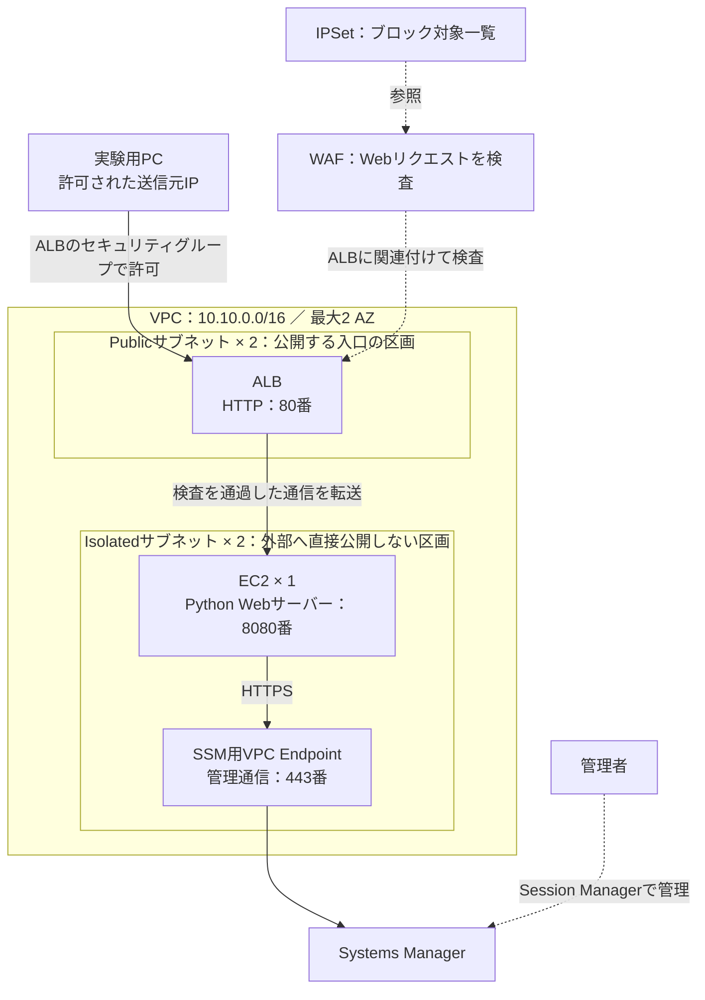
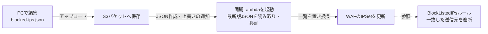
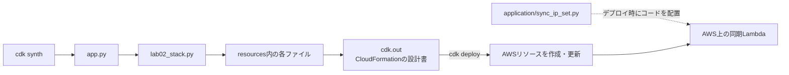
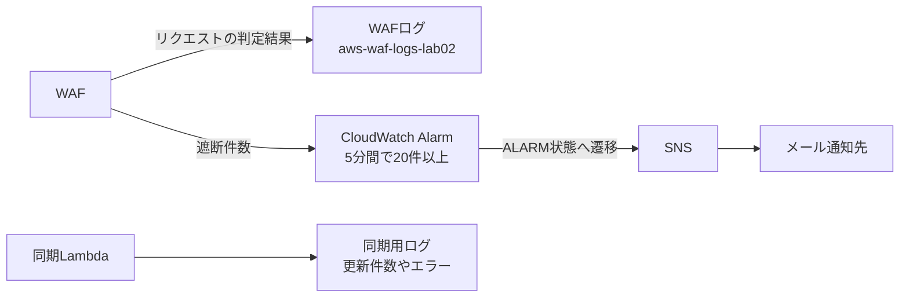

# Lab02：WebサーバーとWAF・IPブロックを学ぶラボ

AWS上に小さなWebサーバーを作り、その手前で通信を検査する学習用プロジェクトです。ブロックしたいIPアドレスをJSONファイルに書いてS3へアップロードすると、LambdaがWAFのブロックリストを更新します。

このREADMEでは、全体の仕組み、各ディレクトリとファイルの役割、変更するときに見る場所を説明します。説明は現在のソースコードに基づきます。コードの存在や合成の成功は、AWS上でのデプロイ・動作確認の完了を意味しません。

## 1. このラボで学べること

- 外部からアクセスできる入口と、外部へ直接公開しないWebサーバーを分ける。
- WAFでIPアドレスやリクエストの内容を検査する。
- S3へのファイル保存をきっかけに、Lambdaを自動実行する。
- ログを使って、通信の判定結果やIPリストの更新結果を確認する。
- PythonのコードからAWSの構成を作成・更新する。

まず全体図を見てから、ファイル一覧を読むと理解しやすくなります。

## 2. AWSの用語を身近な役割で理解する

| 用語 | このラボでの役割 |
|---|---|
| リージョン | AWSを利用する地域。今回は東京（`ap-northeast-1`） |
| VPC | AWS内に作る専用ネットワークの区画 |
| サブネット | VPCをさらに分けた区画。入口用とサーバー用に分ける |
| AZ | リージョン内の、互いに分離された設備の単位 |
| ALB | Webアクセスの受付。届いたリクエストをWebサーバーへ送る |
| EC2 | Webアプリケーションを実行する仮想サーバー |
| セキュリティグループ | 送信元や通信ポートなどから、接続を許可する設定 |
| WAF | Webリクエストを調べ、IPや内容などに応じて遮断・記録する仕組み |
| Web ACL | WAFの検査ルールをまとめた設定 |
| IPSet | WAFルールから参照するIPアドレス一覧 |
| S3 | ファイルを保存するサービス。保存先の入れ物を「バケット」と呼ぶ |
| Lambda | 必要なときにプログラムを実行するサービス。自分でサーバーを管理しない |
| IAMロール | EC2やLambdaに「何をしてよいか」を渡す権限設定 |
| CloudWatch | ログや件数などの監視情報を確認するサービス |
| SNS | このラボでは、アラームをメール通知するサービス |
| Systems Manager／SSM | EC2を管理するサービス。Session Managerで管理用セッションを開く |
| CDK | PythonなどでAWSの構成を定義する開発ツール |
| CloudFormation／Stack | AWSの構成をまとめて作成・更新する仕組み／その管理単位 |

## 3. 全体図：Webアクセスの経路



実線はリクエストや管理通信の流れ、点線は設定の関連付け・参照や管理操作を表します。WAFは、別のサーバーを経由させるのではなく、ALBに関連付けて検査します。

Webアクセスの流れは次のとおりです。

1. 実験用PCからALBのURLへアクセスします。
2. ALBのセキュリティグループが、許可した送信元からの80番への接続を許可します。
3. ALBに関連付けたWAFがリクエストを検査します。
4. 遮断されなかったリクエストを、ALBがEC2の8080番へ送ります。
5. EC2上のPython WebサーバーがJSONを返します。

ポート番号は通信の受付番号のようなものです。ALB側は80番、EC2のWebアプリ側は8080番を使います。現在のWebアクセスはHTTPです。

### ネットワークの要点

| 設定 | 現在の内容 |
|---|---|
| VPCのアドレス範囲 | `10.10.0.0/16` |
| サブネット | 最大2 AZにPublicとPrivate Isolatedを作成。各サブネットは`/24` |
| ALB | Publicサブネットに配置。入口はHTTP 80番 |
| EC2 | Isolatedサブネットに1台。Amazon Linux 2023、`t3.micro` |
| ALB → EC2 | ALBのセキュリティグループからEC2の8080番へ許可 |
| EC2 → SSM Endpoint | EC2からEndpointの443番へ許可 |
| NAT Gateway | 作成しない。EC2からインターネットへ出るための経路は設けない |
| EC2管理 | SSMとSSM MessagesのEndpointを利用。SSH用の22番は開けない |

**「接続を許可するIP」と「WAFで遮断するIP」は別の設定です。** `allowedIpv4`はALBまで接続できる送信元です。ブロック対象IPSetへ追加しても、ALBのセキュリティグループの設定は変わりません。遮断試験には、ALBまで到達できる送信元を使います。

## 4. 全体図：IPリストを更新する経路



WAFは、アクセスのたびにS3のファイルを読みません。ファイル更新時にLambdaがIPSetへ同期し、Webアクセス時はWAFがそのIPSetを参照します。このLambdaはVPC内には配置せず、EC2とは独立して動きます。

JSONは次の形式です。これは例示用IPです。

```json
{
  "addresses": [
    "192.0.2.10/32",
    "198.51.100.0/24"
  ]
}
```

`/32`はIPv4を1個だけ指定する書き方、`/24`は一定の範囲をまとめて指定する書き方です。このような書式をCIDRと呼びます。

- **追加・削除**：JSONの一覧全体をIPSetに反映します。JSONから削除したIPはIPSetからも削除します。
- **全件解除**：`{"addresses": []}`をアップロードします。
- **入力不正**：JSONやCIDRに問題があれば、IPSetを変更せずエラー終了します。
- **ファイル削除**：削除イベントは処理しないので、S3のファイルを削除しても遮断は解除されません。
- **対象ファイル**：通知はバケット内の末尾が`.json`のファイルが対象ですが、Lambdaが読むのは常にバケット直下の`blocked-ips.json`です。

S3のファイルを更新せず、ローカルのJSONを編集しただけではAWSに反映されません。IPSetをコンソールで直接編集した場合も、次の同期ではS3の一覧に置き換わります。

## 5. ディレクトリとファイルの役割

```text
labs/lab02/
├── README.md                    # この説明書
├── app.py                       # CDKの実行開始地点
├── cdk.json                     # CDKの起動方法と動作設定
├── cdk.context.json             # CDKが参照する環境情報のキャッシュ
├── requirements.txt             # 構成定義に使うPythonライブラリ
├── requirements-dev.txt         # テスト用ライブラリ
├── blocked-ips.json             # S3へアップロードするIPリスト
├── lab.sh                       # ローカル作業を補助するシェルスクリプト
├── reqestFluid.sh               # 連続リクエストによるレート制限の実験
├── source.bat                   # Windowsの仮想環境有効化を補助
├── .gitignore                   # Gitへ保存しない生成物などの指定
├── lab02/                       # AWSの構成を定義するPythonコード
│   ├── __init__.py              # Pythonパッケージの印
│   ├── lab02_stack.py           # 各リソースを作成・接続するまとめ役
│   └── resources/               # リソースの種類ごとに分けた定義
│       ├── network.py           # ネットワークと接続許可
│       ├── compute.py           # EC2とWebアプリの起動設定
│       ├── load_balancer.py     # ALBと転送先
│       ├── waf.py               # WAFルールとIPSet
│       ├── ip_list.py           # S3・同期Lambda・権限・通知
│       └── monitoring.py        # ログとアラーム、メール通知
├── application/                 # AWS上で動くアプリケーションコード
│   └── sync_ip_set.py            # JSONを読み取りIPSetを更新するLambda本体
└── tests/                       # CDKの構成を確認するテスト
    ├── __init__.py
    └── unit/
        ├── __init__.py
        └── test_lab02_stack.py
```

ローカルでは`.env`、`.venv/`、`cdk.out/`、`__pycache__/`などが存在する場合もあります。`.env`はローカル設定、`.venv/`はPython実行環境、`cdk.out/`はCDKの生成結果、`__pycache__/`はPythonのキャッシュです。`.env`に認証情報などを書いた場合はGitに保存しないでください。

### 構成定義のファイル

以下のリンクは、このREADMEからの相対パスです。

| ファイル | 何を設定するか |
|---|---|
| [app.py](app.py) | `Lab02Stack`を起動。東京リージョンを指定し、アカウントを`CDK_DEFAULT_ACCOUNT`から取得 |
| [lab02_stack.py](lab02/lab02_stack.py) | ネットワーク→EC2→ALB→WAF→S3・同期Lambda→監視の順で作成関数を呼ぶ。作成したリソースを次の関数へ渡し、名前やURLをOutputsへ出力 |
| [network.py](lab02/resources/network.py) | VPC、サブネット、セキュリティグループ、SSM用Endpoint |
| [compute.py](lab02/resources/compute.py) | EC2の種類、OS、配置先、SSM用IAMロール、IMDSv2必須設定。起動時にWebサーバーとsystemdサービスを配置 |
| [load_balancer.py](lab02/resources/load_balancer.py) | ALBの公開設定、80番の受付、8080番への転送、`/health`のヘルスチェック |
| [waf.py](lab02/resources/waf.py) | IPSet、Web ACL、検査ルール、優先順位、ALBとの関連付け |
| [ip_list.py](lab02/resources/ip_list.py) | S3バケット、同期Lambdaの実行設定、アクセス権限、環境変数、S3通知、Lambdaログ |
| [monitoring.py](lab02/resources/monitoring.py) | WAFログ、5分間に20件以上の遮断を対象とするアラーム、SNSメール通知 |

### 実際の処理・データ・補助ファイル

| ファイル | 役割と読みどころ |
|---|---|
| [sync_ip_set.py](application/sync_ip_set.py) | Lambda上で実行。`validate_addresses()`がIPv4 CIDRを検証し重複を除去。`handler()`がS3の最新版を取得し、`GetIPSet`と`UpdateIPSet`で更新。競合時は最大3回試行 |
| [blocked-ips.json](blocked-ips.json) | 遮断対象のデータ。IPの追加・削除はここを編集してS3へアップロード |
| [cdk.json](cdk.json) | `cdk synth`などが`python3 app.py`を実行する設定。`context`にはCDKの機能設定もある |
| [cdk.context.json](cdk.context.json) | CDKが取得・参照する環境情報のキャッシュ。IPリストの保存場所ではない |
| [requirements.txt](requirements.txt) | `aws-cdk-lib`と`constructs`を指定 |
| [requirements-dev.txt](requirements-dev.txt) | テスト実行用の`pytest`を指定 |
| [lab.sh](lab.sh) | `.env`を読み、SSOログイン・接続先確認・合成・差分・デプロイを補助。現在は`labs/lab01/.venv`を参照するため、別環境ではパスを確認する |
| [reqestFluid.sh](reqestFluid.sh) | `ALB_DNS`を宛先に最大300回、各応答後0.2秒待ちながら順番に送信しHTTPステータスを表示。明示的にレート制限を試すときに使う。ファイル名は現在の綴りのまま記載 |
| [source.bat](source.bat) | Windowsで`.venv`を有効にする補助。Linuxでは通常使わない |
| [.gitignore](.gitignore) | 仮想環境・キャッシュ・CDK生成物をGit管理から除外 |
| [test_lab02_stack.py](tests/unit/test_lab02_stack.py) | VPC・ALB・Web ACLの数、IMDSv2、アラームなどを生成テンプレートで確認。実際のS3通知・IPSet同期・通信遮断は検証しない |
| `__init__.py` | ディレクトリをPythonパッケージとして扱うためのファイル |

## 6. コードを実行すると何が起こるか



`synth`はPythonの定義から設計書を生成する操作です。今回のラボのEC2やWAFを作成するのは`deploy`です。`diff`はAWS上の構成と今回の定義との差分を確認する操作です。

`resources/ip_list.py`は「Lambdaをどの設定で用意するか」、`application/sync_ip_set.py`は「用意されたLambdaが何をするか」を定義します。`cdk.out/`の生成結果を直接編集せず、元のPythonコードを修正してください。

## 7. 変更したいことからファイルを探す

| 変更したいこと | 主に見る場所 |
|---|---|
| ブロックするIPを追加・削除 | `blocked-ips.json`。変更後にS3へアップロード |
| ALBへ接続できるPCのIPを変更 | 実行時の`allowedIpv4`。設定の利用先は`network.py` |
| WAFルールを追加・優先順位を変更 | `waf.py` |
| IPリストの形式や検証方法を変更 | `application/sync_ip_set.py` |
| Lambdaのメモリ・タイムアウト・権限を変更 | `ip_list.py` |
| Webサーバーの応答を変更 | `compute.py`内の`server_script` |
| EC2の性能・OSを変更 | `compute.py` |
| ALBの転送先ポート・ヘルスチェックを変更 | `load_balancer.py`。EC2側の待受とSGは`compute.py`・`network.py`も合わせる |
| 通知先メールを変更 | 環境変数`ALERT_EMAIL`を変更してデプロイ |
| 遮断通知のしきい値を変更 | `monitoring.py` |

EC2の起動処理に書いたWebサーバーを変更する場合、ファイルの編集だけで稼働中のサーバーへ即時反映されるわけではありません。差分と、実際のEC2への反映方法を確認してください。

### 現在のWAFルール

| 優先順位 | ルール | 動作 |
|---:|---|---|
| 0 | `BlockListedIPs` | ブロック対象IPSetに一致すると遮断 |
| 10 | `AWSManagedRulesCommonRuleSet` | 一般的なWeb攻撃の検査。グループの結果をCountに上書き |
| 20 | `AWSManagedRulesSQLiRuleSet` | SQLインジェクションに関連する内容を検知すると遮断 |
| 30 | `Lab02RateLimit` | 同じ送信元IPの直近60秒・100件を基準に制限 |
| 最後 | デフォルト動作 | 許可 |

小さい番号から順番に評価し、遮断が確定すると後続へ進みません。Countは記録して検査を続ける動作です。レート制限は「厳密に101件目を遮断する」という保証ではありません。

## 8. ローカルで確認する最小手順

Python、AWS CLI、Node.jsとCDK CLI、および対象AWSアカウントのプロファイルを用意します。以下はLinuxの例です。`YOUR_PROFILE_NAME`、メールアドレス、IPは自分の環境へ置き換えます。

```bash
cd ~/workspace/awsLab/labs/lab02
python3 -m venv .venv
source .venv/bin/activate
python -m pip install -r requirements.txt -r requirements-dev.txt

export AWS_PROFILE='YOUR_PROFILE_NAME'
export ALERT_EMAIL='your-address@example.com'
export ALLOWED_IPV4='203.0.113.10/32'
```

上のIPは例示用です。実際のPCのグローバルIPv4を指定してください。`ALLOWED_IPV4`はシェル変数名、`allowedIpv4`はCDKへ渡す設定名です。

```bash
# ローカルの構成テスト
python -m pytest tests -q

# 設計書を生成。EC2やWAFは作成しない
cdk synth Lab02Stack --no-lookups \
  -c "allowedIpv4=$ALLOWED_IPV4" --quiet

# 接続するAWSアカウントを確認
aws sts get-caller-identity --profile "$AWS_PROFILE"

# AWS上の構成との差分を確認
cdk diff Lab02Stack --profile "$AWS_PROFILE" \
  -c "allowedIpv4=$ALLOWED_IPV4" --no-change-set
```

初めてCDKを使うアカウント・リージョンでは、CDKの準備用リソースを作る`bootstrap`が必要になる場合があります。対象アカウントと権限を確認してから行います。

差分を確認して構築するときは、次を実行します。デプロイするとEC2・ALB・WAF・VPC Endpointなどが作成され、料金が発生します。

```bash
cdk deploy Lab02Stack --profile "$AWS_PROFILE" \
  -c "allowedIpv4=$ALLOWED_IPV4"
```

### デプロイ後に表示される情報

| Output | 用途 |
|---|---|
| `AlbUrl`／`AlbDnsName` | Webアクセス先／ALBのホスト名 |
| `WebInstanceId`／`WebInstancePrivateIp` | EC2の識別子／VPC内のIP |
| `VpcId` | ネットワークの識別子 |
| `IpListBucketName` | JSONのアップロード先 |
| `BlockedIpSetId` | 同期先IPSetの識別子 |
| `IpListSyncFunctionName` | ログを確認するLambdaの名前 |

## 9. IPリストを反映して確認する

デプロイ完了後、`blocked-ips.json`を編集してアップロードします。構築コードを変更しないIP一覧の更新には、通常CDKの再デプロイは不要です。

```bash
IP_LIST_BUCKET='Outputsに表示されたバケット名'

aws s3 cp blocked-ips.json "s3://$IP_LIST_BUCKET/blocked-ips.json" \
  --profile "$AWS_PROFILE" --region ap-northeast-1
```

AWSコンソールでは、同じアカウント・東京リージョンで次を確認します。

1. **S3**：対象バケットの直下に`blocked-ips.json`がある。
2. **Lambda**：`IpListSyncFunctionName`の関数の「モニタリング → CloudWatchログを表示」で、同期成功またはエラーを確認する。
3. **WAF → IP sets**：`lab02-blocked-ipv4`の一覧がJSONと一致する。
4. **WAFのWeb ACL**：`lab02-web-acl`でルールとALBとの関連付けを確認する。

成功ログの例：

```text
IPSet synchronized: address_count=1
```

IPSetへの反映確認と、実際に通信が遮断されることの確認は別です。通信の実験では、許可された送信元からのアクセス結果と、WAFログの一致ルールを合わせて確認します。反映には時間がかかる場合があります。

## 10. ログ・通知と片付け



- WAFログは「どの通信が、どのルールに一致したか」を確認するものです。
- Lambdaログは「IPリストを正常に同期できたか」を確認するものです。
- どちらも保存期間は7日で、Stack削除時には削除する設定です。
- 通知先メールはSNSの購読確認が必要です。メトリクス取得・アラーム発報・メール到達は実測で確認します。
- S3バケットはStack削除時にも残る設定です。実験終了時には、残ったバケットと過去バージョンを含むファイルを確認して別途片付けます。
- IPSetの初期値はCDKで空の一覧として定義しています。Lambdaによる変更はCloudFormationの設計書へ書き戻されないため、IPSetを再作成した場合などはS3から再同期します。

より詳しい構成図は[Lab02の構成とIPSet同期の仕組み](../../docs/lab02-architecture.md)を参照してください。
