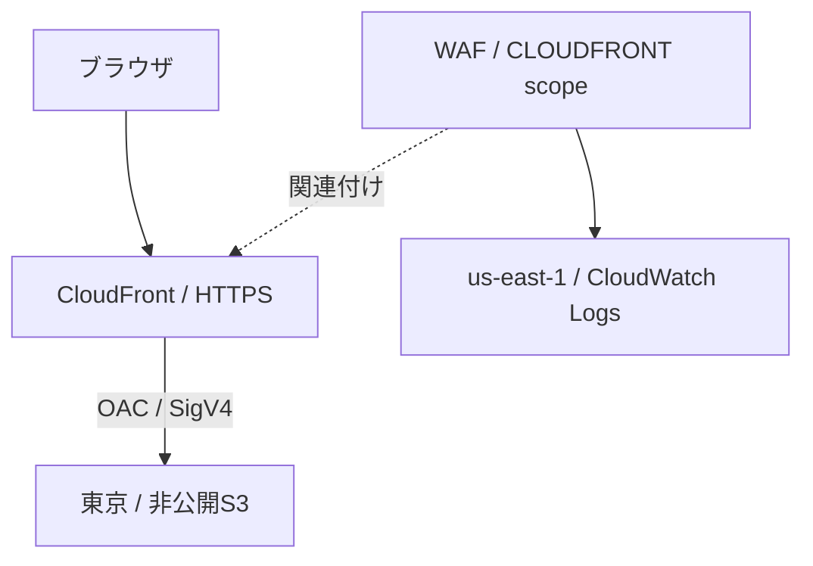

# Lab04：CloudFront・非公開S3・WAF（基本編）

Python CDKで、東京の非公開S3に置いた静的コンテンツをCloudFrontで配信し、キャッシュとWAFを検証します。Lab01〜03には依存しません。AWSリソースはデプロイするまで作成されません。

## 構成と学習範囲



| Stack | リージョン | リソース |
|---|---|---|
| `Lab04EdgeStack` | `us-east-1` | CloudFront、OAC、キャッシュポリシー、WAF、IPv4 IPSet、WAFログ |
| `Lab04OriginStack` | `ap-northeast-1` | S3、配信元ポリシー、HTMLの自動配置 |

CloudFront自体はグローバルサービスです。配信拠点を2リージョンに固定する設定ではありません。基本編ではS3は東京の1つだけです。独自ドメイン・ACM・ALB・EC2・NAT Gateway・2リージョンのオリジン切り替えは追加しません。

S3はBlock Public Accessをすべて有効にし、CloudFrontサービスプリンシパルに対し、このDistributionのARNを条件として`GetObject`を許可します。S3のWebサイトホスティングは使いません。HTTPアクセスはHTTPSへリダイレクトします。CloudFrontからS3への通信はOACが署名します。

S3名は`lab04-content-<AWSアカウントID>-ap-northeast-1`です。1アカウントにつき同名Lab04環境は1つを想定します。CloudFront側はこの名前からS3を参照し、東京側のバケットポリシーがDistributionのARNを参照します。逆方向にスタック参照を作らず、循環依存を避けています。CDKのcross-region referencesにより補助リソースも生成されます。

作成順はEdge→Originです。Edge作成中はまだS3が存在しないため、両Stackの完了後にアクセスを検証してください。

## ファイル

```text
app.py                       # 2つのStackとリージョン
cdk.json                     # CDKの起動方法
requirements*.txt            # CDK / pytest（バージョン固定）
lab04/edge_stack.py           # CloudFront・WAF・ログ
lab04/origin_stack.py         # 非公開S3・ポリシー・コンテンツ配置
application/index.html       # キャッシュ実験用ページ
application/blocked-test     # 実在するがWAFで遮断するファイル
tests/unit/test_lab04.py      # 構成・参照・入力検証
../../.github/workflows/lab04.yml  # CIと自動デプロイ
```

## 1. ローカル準備とAWSに接続しない検証

前提：Python 3.12以上、Node.js 24、CDK CLI v2、AWS CLI v2（構築以降で使用）。GitHub ActionsはPython 3.12 / Node.js 24を使用します。

```bash
cd ~/workspace/awsLab/labs/lab04
python3 -m venv .venv
source .venv/bin/activate
python -m pip install -r requirements.txt -r requirements-dev.txt
npm install --global aws-cdk@2.1148.1
python -m pytest tests -q
CDK_DEFAULT_ACCOUNT=111111111111 cdk synth --no-lookups --quiet
```

`111111111111`は合成専用のダミーアカウントです。テスト・synthはデプロイではありません。以降のデプロイにこのダミー値を引き継がないでください。実際の通信やWAFの伝播はpytestでは検証しません。

## 2. 手動構築（構築すると決めたときに実行）

対象アカウントへログインし、IDを確認してください。以下の`my-profile`とアカウントIDを置き換えます。

```bash
export AWS_PROFILE=my-profile
aws sso login --profile "$AWS_PROFILE"  # SSO利用時
aws sts get-caller-identity
export CDK_DEFAULT_ACCOUNT=123456789012  # 上で確認した実アカウントID

# 初回のみ。両リージョンにCDK Toolkitを用意します。
cdk bootstrap "aws://$CDK_DEFAULT_ACCOUNT/us-east-1" \
              "aws://$CDK_DEFAULT_ACCOUNT/ap-northeast-1"

cdk diff --all --no-lookups
cdk deploy --all --no-lookups --outputs-file cdk.out/outputs.json
```

CloudFrontの作成・削除には時間がかかります。Outputの`DistributionUrl`、`DistributionId`、`BucketName`を控えます。デプロイは`application/`をS3へ自動配置します。コンテンツ更新後のCloudFront Invalidationは自動実行しません。キャッシュ挙動を検証するため、別途操作します。

WAFはWeb ACL・ルール・リクエストに応じた料金、ログにも保存・取り込み等の料金が発生します。S3・CloudFront・CDKの補助リソースにも利用に応じた料金があります。ログ保持は7日です。

## 3. 配信とS3の非公開設定を確認

```bash
export LAB04_URL=https://xxxxxxxxxxxxxx.cloudfront.net
export LAB04_DISTRIBUTION_ID=EXXXXXXXXXXXXX
export LAB04_BUCKET=lab04-content-123456789012-ap-northeast-1

curl -i "$LAB04_URL/"                       # 200、Content version: v1
curl -I "http://${LAB04_URL#https://}/"      # HTTPSへのリダイレクト
curl -I "https://$LAB04_BUCKET.s3.ap-northeast-1.amazonaws.com/index.html"
# 最後の匿名アクセスは403。CloudFront経由だけで読めることを確認。
```

S3直接アクセスの403とWAFによる403は別の結果です。後述のWAFログを合わせて判定します。

## 4. キャッシュを確認

```bash
curl -sS -D - -o /dev/null "$LAB04_URL/index.html"
curl -sS -D - -o /dev/null "$LAB04_URL/index.html"
```

`X-Cache: Miss from cloudfront`から`Hit from cloudfront`への変化と、`Age`を確認します。エッジ拠点や有効期限によって結果は変わります。キャッシュポリシーは既定60秒・最小0秒・最大300秒、配置ファイルの`Cache-Control`は`max-age=60`です。クエリ文字列・Cookieはキャッシュキーに含めません。`?v=2`を付けてもキャッシュの回避にはなりません。

1. `application/index.html`の`v1`を`v2`に変更。
2. `cdk deploy --all --no-lookups`で更新（または後述のCI/CD）。
3. 更新直後は古いページが返る場合があることを確認。
4. 60秒程度待つか、次のInvalidationを実行して再取得。

```bash
aws cloudfront create-invalidation \
  --distribution-id "$LAB04_DISTRIBUTION_ID" --paths '/' '/index.html'
```

返されたInvalidation IDについて`aws cloudfront wait invalidation-completed --distribution-id "$LAB04_DISTRIBUTION_ID" --id <ID>`で完了を待てます。複数のパスで同じページをキャッシュできるため、`/`と`/index.html`を両方無効化します。

## 5. WAFを確認

| 優先順位 | ルール | 初期動作 |
|---:|---|---|
| 0 | `/blocked-test`への完全一致 | Block |
| 10 | IPv4 IPSet（初期値は空） | 一致したらBlock |
| 20 | AWSManagedRulesCommonRuleSet | グループの結果をCountに上書き |
| 30 | AWSManagedRulesSQLiRuleSet | グループの結果をCountに上書き |
| 40 | 送信元IPごとに100件 / 60秒 | Block |
| 最後 | デフォルト | Allow |

WAFはキャッシュHitのリクエストも検査します。

### 確実にルールに一致するパス

```bash
curl -i "$LAB04_URL/blocked-test"  # 403
curl -i "$LAB04_URL/index.html"    # 200（IPSet等に一致しない場合）
```

`/blocked-test`はS3に実在します。CloudWatch Logsの`us-east-1` → `aws-waf-logs-lab04`で、`action=BLOCK`と`terminatingRuleId=BlockTestPath`を確認して、WAFが遮断したことを判断します。

Logs Insightsの例：

```text
fields @timestamp, action, terminatingRuleId, httpRequest.clientIp, httpRequest.uri
| sort @timestamp desc
| limit 50
```

### IPv4を遮断

現在のグローバルIPv4を確認し、`cdk.json`の`context`に追加してデプロイします。例のIPは実際のアクセス元に置き換えます。

```json
"context": {
  "blockedIpv4": "192.0.2.10/32",
  "managedRulesBlock": "false"
}
```

```bash
cdk diff --all --no-lookups
cdk deploy --all --no-lookups
curl -4 -i "$LAB04_URL/index.html"
```

反映後に403、ログに`BlockListedIPs`が出ることを確認します。このIPSetはIPv4用です。IPv6経由のリクエストはこのリストには一致しません。解除は`blockedIpv4`を空文字にして再デプロイします。

一時的に`-c blockedIpv4=<IP>/32`を渡す方法もありますが、CI/CDはその引数を使いません。継続したい設定は`cdk.json`に保存してコミットしてください。コンソールでIPSetを直接変更した場合もコードとの不一致が生じます。

### 管理ルールをCountからBlockに変更

Countの間に、通常アクセスと検証リクエストのログを比較します。ログ内の`ruleGroupList`や`nonTerminatingMatchingRules`も確認してください。例えば次のSQL風クエリを使えます（検知ルールはログで確認）。

```bash
curl -i --get --data-urlencode "q=' OR 1=1--" "$LAB04_URL/index.html"
```

`cdk.json`の`managedRulesBlock`を文字列`"true"`にすると、2つの管理ルールグループの既定アクションを適用します。diff→deployの後、同じリクエストの応答とログを比較します。終了時は`"false"`へ戻します。

### レート制限（任意）

IPSetによる遮断を解除してから、自分のLab04にだけ実行します。

```bash
for i in $(seq 1 150); do
  curl -4 -sS -o /dev/null -w '%{http_code}\n' "$LAB04_URL/index.html"
  sleep 0.1
done
```

60秒間の件数が基準を超える速度で送れた場合、403と`RateLimit`のログを確認できます。WAFのレート制限は近似評価で、101件目から必ず遮断する保証はありません。遅い回線では150回送っても基準に達しない場合があります。終了後は制限解除を待ちます。

## 6. GitHub Actions：lab04ブランチで自動デプロイ

`.github/workflows/lab04.yml`を追加しています。既存Lab02のワークフローは変更しません。

- Lab04のファイルまたはワークフローを変更したpush / PR：pytest→AWS認証なしのsynth。
- **`lab04`ブランチのpushで上記が成功した場合：OIDC認証→diff→Lab04の2 Stackを自動デプロイ。**
- 他ブランチとPRではデプロイしません。手動実行は`lab04`ブランチを選択した場合にデプロイします。
- 同じブランチの実行は直列化し、進行中のCloudFormation処理をキャンセルしません。
- ローカルのブランチ名変更・コミット・pushはこの実装では行いません。pushが最初のデプロイ開始操作になります。

### 初回に必要なGitHub / AWS側の設定

1. リポジトリのSettings → Environmentsに`lab04`を作成。
2. Environment variablesに次を登録。

   | 名前 | 値 |
   |---|---|
   | `AWS_ROLE_ARN` | GitHub Actionsが引き受けるIAMロールのARN |
   | `AWS_ACCOUNT_ID` | デプロイ先の12桁AWSアカウントID |

3. EnvironmentのDeployment branchesは`lab04`を許可。完全自動にする場合、Required reviewersやWait timerを設定しません。
4. AWS側のGitHub OIDC ProviderとIAMロールを設定。静的アクセスキーは不要です。
5. 同一アカウントの`us-east-1`と`ap-northeast-1`をCDK bootstrap済みにする。

OIDCロールの信頼ポリシーの例（アカウントIDを置換）。Environmentを使うため`sub`はブランチ形式ではなくEnvironment形式です。ブランチ制限はGitHub Environment側にも設定します。

```json
{
  "Version": "2012-10-17",
  "Statement": [{
    "Effect": "Allow",
    "Principal": {
      "Federated": "arn:aws:iam::123456789012:oidc-provider/token.actions.githubusercontent.com"
    },
    "Action": "sts:AssumeRoleWithWebIdentity",
    "Condition": {
      "StringEquals": {
        "token.actions.githubusercontent.com:aud": "sts.amazonaws.com",
        "token.actions.githubusercontent.com:sub": "repo:AllmayJapan/awsLab:environment:lab04"
      }
    }
  }]
}
```

OIDCロールには両リージョンのCDK bootstrapのdeploy / file-publishing / lookupロールを引き受ける権限と、CDKが必要なStack情報を読み取る権限が必要です。CDKのCloudFormation実行ロールには、S3・CloudFront・WAFv2・Logs・IAM・Lambda・SSM等（cross-region参照とコンテンツ配置の補助リソースを含む）の作成・更新・削除権限が必要です。既存Lab02ロールを流用する場合、東京だけの権限や`lab02` Environmentだけの信頼条件では不足します。実際のARN・bootstrap qualifier・組織の権限方針に合わせて設定してください。ワークフローはbootstrapやIAM信頼設定を自動変更しません。

必要な設定が未登録なら、デプロイジョブは明示的にエラー終了します。権限の確認は実際のデプロイ時に行われます。ここではGitHub Environment / IAM / AWSリソースの変更は行っていません。

現在別ブランチにいる場合は、変更を確認してから`git switch -c lab04`で作業ブランチを作成できます。既存`lab04`ブランチがある場合はその内容を確認して切り替えてください。Lab04のコードとワークフローをコミットし、**デプロイを開始すると決めた時点で**`git push -u origin lab04`を実行します。

## 7. 削除

GitHub Actionsによる再作成を避けるため、先に`lab04` Environmentでデプロイを止めるか、このワークフローを無効化します。その後、同じプロファイル・アカウントで、作成と逆の順に削除します。

```bash
cd ~/workspace/awsLab/labs/lab04
source .venv/bin/activate
export AWS_PROFILE=my-profile
aws sts get-caller-identity
export CDK_DEFAULT_ACCOUNT=123456789012

cdk destroy Lab04OriginStack
cdk destroy Lab04EdgeStack
```

このLabのS3は`auto_delete_objects=True`と`RemovalPolicy.DESTROY`を設定しています。**Origin Stackの削除ではバケット内のファイルも削除されます。学習用ファイル以外を入れないでください。** Edge Stackの削除ではCloudFront・WAF・7日保持のログも削除されます。CloudFrontの削除待ちが発生します。

CloudFormationコンソールで両Stackの削除完了を確認し、残ったリソースがないか確認します。失敗時はStackのイベントで原因を確認してから再実行します。CDKToolkitのバケット・ECR・IAMなどbootstrapリソースは残ります。他Labと共有するため、この手順では削除しません。bootstrapにアップロードされた過去アセットも、Lab04 Stack削除だけではすべて削除されません。

## 参考

- [S3オリジンとOAC](https://docs.aws.amazon.com/AmazonCloudFront/latest/DeveloperGuide/private-content-restricting-access-to-s3.html)
- [CloudFront用WAFのScopeと作成リージョン](https://docs.aws.amazon.com/AWSCloudFormation/latest/TemplateReference/aws-resource-wafv2-webacl.html)
- [CloudFrontではDistribution側でWeb ACLを関連付け](https://docs.aws.amazon.com/AWSCloudFormation/latest/TemplateReference/aws-resource-wafv2-webaclassociation.html)
- [GitHub ActionsでAWS OIDCを使用](https://docs.github.com/en/actions/how-tos/secure-your-work/security-harden-deployments/oidc-in-aws)
